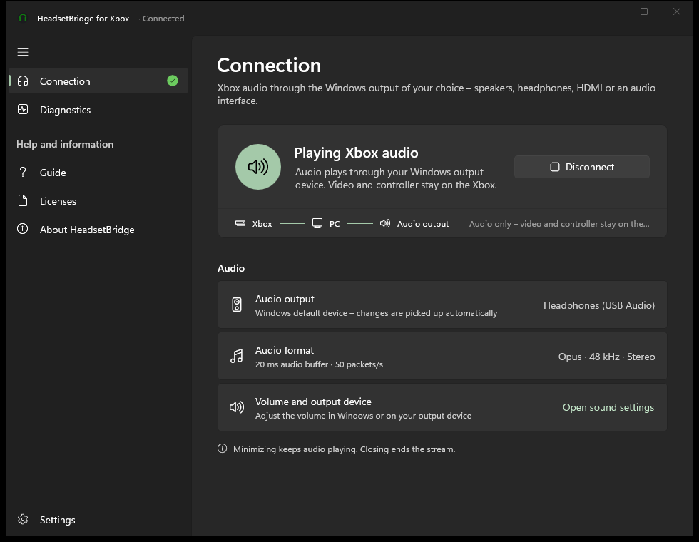

# HeadsetBridge für Xbox

**Der Ton deiner Xbox auf jedem Windows-Ausgabegerät – Lautsprecher, Kopfhörer, HDMI oder Audio-Interface.**
[English version](README.md)

HeadsetBridge öffnet dieselbe **Remote-Play**-Sitzung wie die offizielle Xbox-App, fordert von der Konsole aber **nur den Ton** an und gibt ihn auf dem Standardausgabegerät deines PCs wieder. Das Bild bleibt am Fernseher, gespielt wird weiter mit dem Controller der Konsole – der Spielsound kommt einfach aus deinem PC-Headset. Praktisch für Headsets, die sich nicht direkt mit einer Xbox verbinden lassen.



> **Status:** 2.0.0. Neue Windows-11-App und verschlankte, übersetzte Audio-Engine. Vollständig getestet mit einer **Xbox Series X** und einem **Windows-11**-PC; Protokoll und Pufferung sind zusätzlich durch automatische Tests abgesichert. Andere Konsolenmodelle und Netzwerke sind noch ungetestet – siehe [Einschränkungen](#einschränkungen).

Screenshots aller Seiten: siehe [englische README](README.md#screenshots) (aufgenommen im Vorschau-Modus `HeadsetBridge.exe --demo`).

## Funktionen

- App im Windows-11-Stil (WinUI 3, Mica, Akzentfarbe, Hell/Dunkel/System), **Deutsch und Englisch**, im laufenden Betrieb umschaltbar
- Verbinden mit einem Klick; beim ersten Mal Anmeldung mit dem Microsoft-Konto der Xbox per Code – die App fragt nie nach einem Passwort
- Folgt dem **Windows-Standardausgabegerät** und wechselt automatisch mit (z. B. beim Einstecken eines USB-Headsets)
- Geringe Latenz: Opus 48 kHz Stereo mit 20-ms-Jitterpuffer, redundantes Audio (RED) gegen WLAN-Paketverluste, Verdeckung verlorener Pakete
- Weckt eine Konsole im Standby, verbindet sich nach Abbrüchen selbst neu (1–16 s, danach alle 30 s Prüfung, ob die Konsole an ist)
- Diagnose in verständlicher Sprache, kopierbar; Anmeldecodes und Zugangsdaten werden nie angezeigt oder protokolliert
- Minimieren lässt den Ton weiterlaufen, Schließen beendet die Sitzung auf der Konsole
- Eigenständig: weder .NET noch WebView2 oder eine andere Laufzeit muss installiert werden

## Installation

1. `HeadsetBridge-Setup-<Version>.exe` (oder die portable ZIP) unter [Releases](../../releases) herunterladen.
2. Ausführen. Das Setup installiert nur für dein Windows-Konto – ohne Administratorrechte.
3. Auf der Xbox **Einstellungen › Geräte und Verbindungen › Remotefeatures** aktivieren. PC und Xbox müssen im selben Heimnetz sein.
4. In den Windows-Soundeinstellungen das Ausgabegerät wählen, *HeadsetBridge* öffnen und auf **Mit Xbox verbinden** klicken.

Die Dateien sind noch nicht signiert; Windows SmartScreen kann deshalb warnen („Weitere Informationen“ → „Trotzdem ausführen“).

Update von 1.x: Das Setup entfernt die alte WebView2-Version, und die Engine übernimmt die vorhandene Anmeldung – eine neue Anmeldung ist nicht nötig.

## Bauen

Voraussetzungen und Befehle stehen in der [englischen README](README.md#building); kurz:

```powershell
powershell -ExecutionPolicy Bypass -File .\Build.ps1
```

Ergebnis unter `dist\`: Setup und portable ZIP. Texte beider Sprachen stehen in `src/HeadsetBridge.Core/L.cs`.

## Einschränkungen

- **Getestete Hardware:** Xbox Series X mit Windows-11-PC. Xbox Series S und Xbox One sollten genauso funktionieren (gleiches Remote-Play-Protokoll), sind aber ungetestet.
- Nur Ton – kein Bild, keine Controller-Weiterleitung, kein Party-/Chat-Audio und kein Mikrofon.
- Xbox und PC müssen im selben Netz sein, Remotefeatures aktiv; nur eine Remote-Play-Sitzung gleichzeitig (Browser-Sitzungen vorher beenden).
- Noch nicht signiert.

Änderungen: [CHANGELOG.md](CHANGELOG.md).

Die Audio-Engine basiert auf [HeadsetBridge for Xbox](https://github.com/MGPersonalProfile/headsetbridge-for-xbox) (MIT). Keine offizielle Microsoft-Anwendung; Xbox ist eine Marke der Microsoft-Unternehmensgruppe.

## Unterstützung

Wenn dir HeadsetBridge hilft, kannst du die Entwicklung unterstützen:

<a href='https://ko-fi.com/D3U62AJLQD' target='_blank'></a>

## Lizenz

[MIT](LICENSE) – ohne Gewähr.
