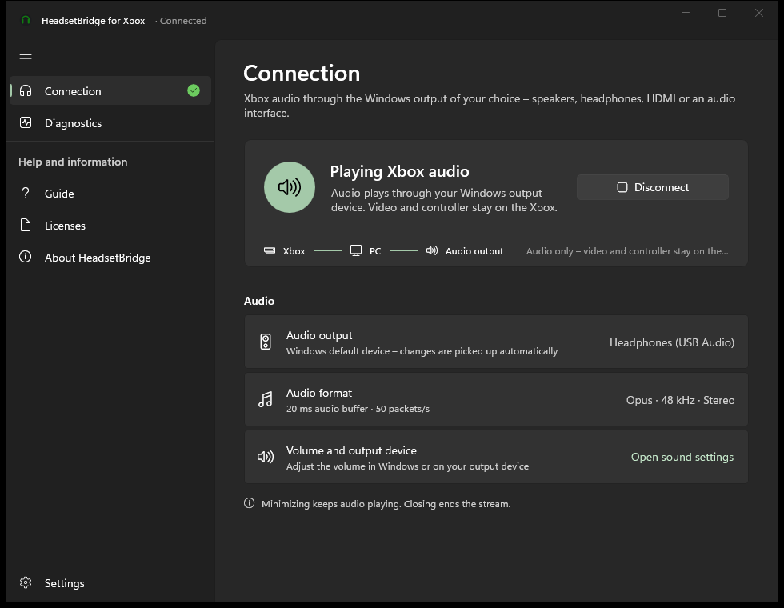
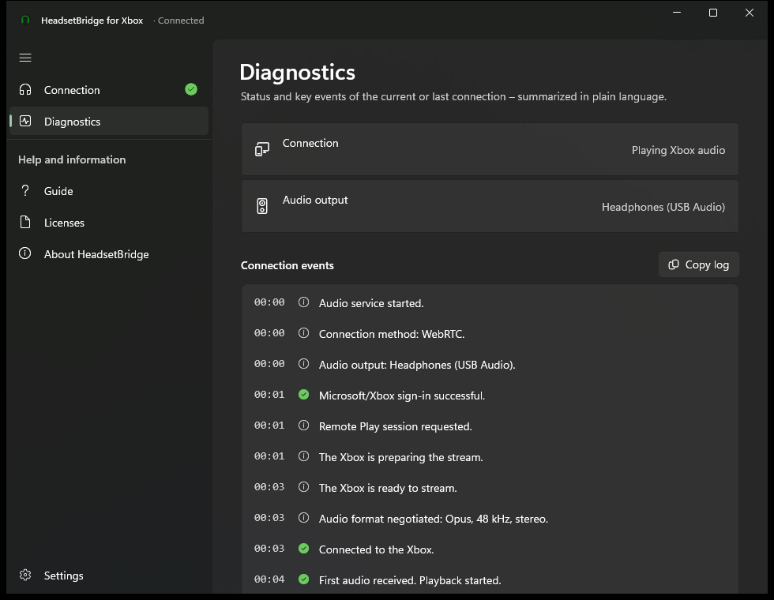
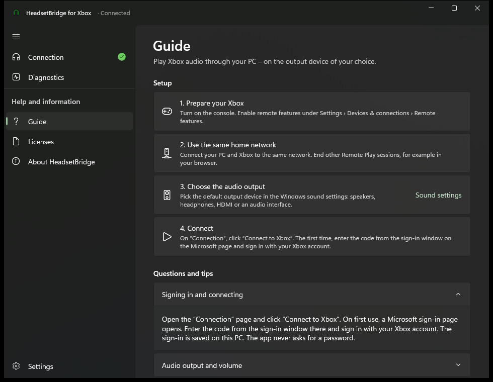
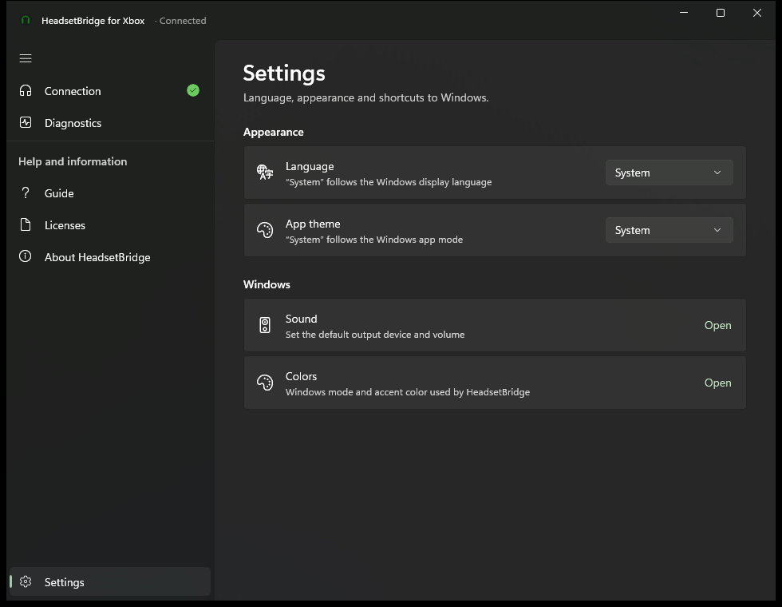
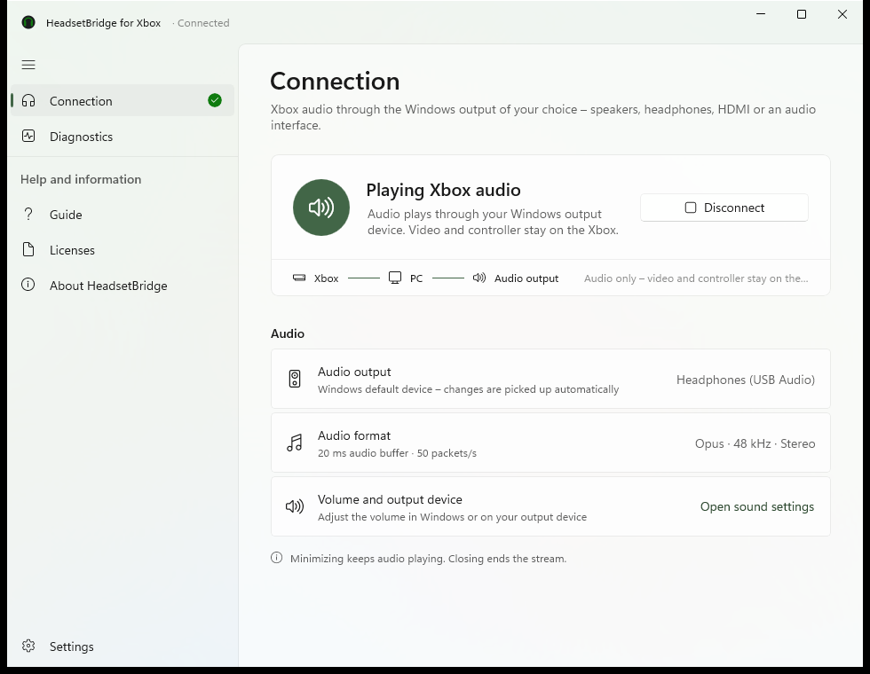
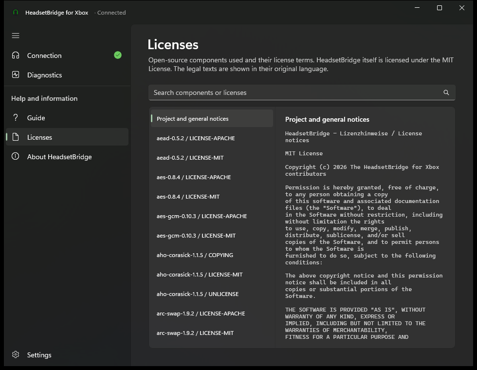
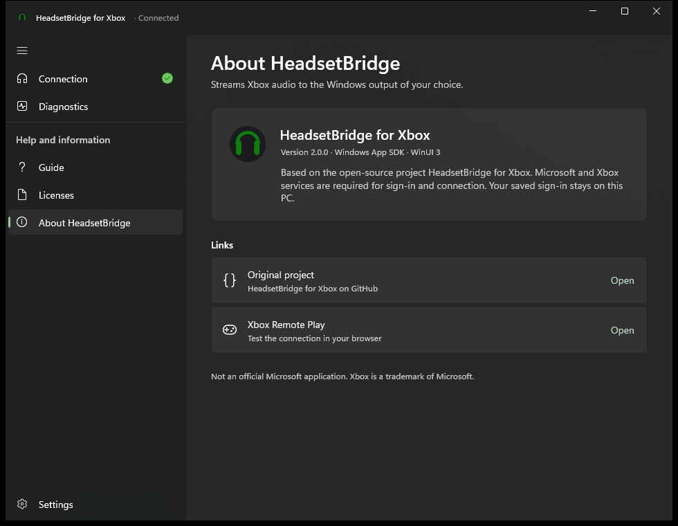

# HeadsetBridge for Xbox

**Play your Xbox's audio on any Windows output device – speakers, headphones, HDMI or an audio interface.**
[Deutsche Version](README.de.md)

HeadsetBridge opens the same **Remote Play** session the official Xbox app uses, but asks the console for **audio only** and plays it on your PC's default output device. The picture stays on the TV and you keep playing with the console's own controller – the game sound simply comes out of your PC headset. Handy for headsets that cannot connect to an Xbox directly.



> **Status:** 2.0.0. New Windows 11 app and a slimmed-down, translated audio engine. Tested end to end with an **Xbox Series X** and a **Windows 11** PC; protocol and buffering are additionally covered by automated tests. Other console models and network setups have not been tested yet – see [Limitations](#limitations).

## Screenshots

| Diagnostics | Built-in guide |
|---|---|
|  |  |
| **Settings** | **Light theme** |
|  |  |
| **Licenses** | **About** |
|  |  |

<sub>Screenshots from the preview mode (`HeadsetBridge.exe --demo`) with a simulated connection.</sub>

## Features

- Windows 11 style app (WinUI 3, Mica, accent color, light/dark/system), **English and German**, switchable at runtime
- One click to connect; the first time you sign in with the Microsoft account of your Xbox (device code – the app never asks for a password)
- Follows the **Windows default output device** and switches automatically when it changes (e.g. when a USB headset is plugged in)
- Low latency: Opus 48 kHz stereo with a 20 ms jitter buffer, redundant audio (RED) against Wi-Fi packet loss, packet loss concealment
- Wakes a console in standby, reconnects by itself after drops (1–16 s, then checks every 30 s whether the console is on)
- Diagnostics in plain language, copyable; sign-in codes and credentials are never shown or logged
- Minimizing keeps audio playing, closing ends the session on the console
- Self-contained: no .NET, WebView2 or other runtime needs to be installed

## Installation

1. Download `HeadsetBridge-Setup-<version>.exe` (or the portable ZIP) from [Releases](../../releases).
2. Run it. The setup installs for your Windows account only – no administrator rights needed.
3. On the Xbox, enable **Settings › Devices & connections › Remote features**. PC and Xbox must be on the same home network.
4. Choose your output device in the Windows sound settings, open *HeadsetBridge* and click **Connect to Xbox**.

The files are not code-signed yet, so Windows SmartScreen may show a warning (“More info” → “Run anyway”).

Upgrading from 1.x: the setup removes the old WebView2-based version, and the engine takes over your existing sign-in, so you do not have to sign in again.

## How it works

| Part | Purpose |
|---|---|
| `src/HeadsetBridge.App` | WinUI 3 app (.NET 8, Windows App SDK 1.8) |
| `src/HeadsetBridge.Core` | Engine control, log interpretation, texts in both languages (`L.cs`), license parser, preview mode |
| `tests/HeadsetBridge.Core.Tests` | xUnit tests for status detection, translations and licenses |
| `engine` | Audio engine in Rust: sign-in, xHome signalling, WebRTC, jitter buffer, WASAPI output – see [engine/README.md](engine/README.md) |
| `installer` | NSIS setup (English/German, per-user) |
| `tools` | `Update-Licenses.ps1` generates the license notices from the components actually shipped |

The app starts `engine\headsetbridge-engine.exe`, reads its log (`%LOCALAPPDATA%\HeadsetBridge\engine\engine.log`) to show the connection state and stops it through the named pipe `headsetbridge-engine`. The sign-in is stored in `%LOCALAPPDATA%\HeadsetBridge\engine\account.json` – it contains credentials, do not share it.

## Building

Requirements: Windows 10/11 x64 and

```powershell
winget install Rustlang.Rustup Kitware.CMake Ninja-build.Ninja BrechtSanders.WinLibs.POSIX.UCRT NSIS.NSIS Microsoft.DotNet.SDK.8
rustup toolchain install stable-x86_64-pc-windows-gnu
```

Then:

```powershell
powershell -ExecutionPolicy Bypass -File .\Build.ps1             # libopus, engine, all tests, licenses, app, setup, ZIP
powershell -ExecutionPolicy Bypass -File .\Build.ps1 -SkipTests
```

Output in `dist\`: `HeadsetBridge-Setup-<version>.exe` and `HeadsetBridge-<version>-portable.zip`.

For working on the user interface the .NET SDK is enough; without a built engine the app shows a hint, and `--demo` simulates a connection:

```powershell
dotnet build src/HeadsetBridge.App -p:Platform=x64
dotnet test tests/HeadsetBridge.Core.Tests
src\HeadsetBridge.App\bin\x64\Debug\net8.0-windows10.0.19041.0\win-x64\HeadsetBridge.exe --demo --lang=en --theme=dark
```

## Limitations

- **Tested hardware:** Xbox Series X with a Windows 11 PC. Xbox Series S and Xbox One should work the same way (same Remote Play protocol) but have not been tested.
- Audio only – no video, no controller passthrough, no party/chat audio and no microphone.
- Needs the Xbox and the PC on the same network with remote features enabled; only one Remote Play session at a time (close browser sessions first).
- Not code-signed yet.

Changes: [CHANGELOG.md](CHANGELOG.md).

## Acknowledgements

The audio engine is derived from [HeadsetBridge for Xbox](https://github.com/MGPersonalProfile/headsetbridge-for-xbox) (MIT). Protocol references: [Greenlight](https://github.com/unknownskl/greenlight) and [xal-node](https://github.com/unknownskl/xal-node). See [engine/THIRD_PARTY_LICENSES.md](engine/THIRD_PARTY_LICENSES.md); the full license texts of all shipped components are in the app under *Licenses*.

Not affiliated with, endorsed or sponsored by Microsoft. Xbox is a trademark of the Microsoft group of companies.

## Support

If HeadsetBridge is useful to you, you can support its development:

<a href='https://ko-fi.com/D3U62AJLQD' target='_blank'></a>

## License

[MIT](LICENSE) – provided “as is”, without warranty of any kind.
